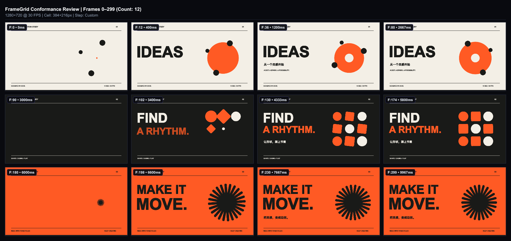
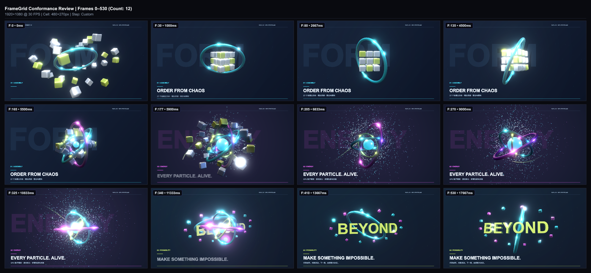

# Framefields Motion Studies

用 TypeScript 编排两段可重渲染动效：10 秒几何排版 **MAKE IT MOVE**，以及 18 秒 3D/粒子练习 **BEYOND**。适合作为代码驱动动画、原生 WebGPU 场景与程序配乐的学习项目。

[直接观看成片](https://yangwei251003.github.io/framefields-motion-demo/) · [第三方与字体说明](THIRD_PARTY_NOTICES.md)




## 环境与最简运行

仅观看无需安装。重新制作需要 Node.js 24、npm、支持原生 WebGPU 的 GPU/驱动与合法字体；本机验证环境为 Windows / AMD D3D12。Linux/macOS 与其他显卡未实测。

```sh
npm ci --ignore-scripts
npm rebuild skia-canvas --ignore-scripts=false
```

Windows 默认查找系统 Fonts 下的 arialbd.ttf 与 HarmonyOS_Sans_SC_Bold.ttf。缺少时，使用自己合法安装的字体设置以下环境变量（PowerShell）：

```powershell
$env:FRAMEFIELDS_DISPLAY_FONT = 'D:/MyFonts/Display-Bold.ttf'
$env:FRAMEFIELDS_CHINESE_FONT = 'D:/MyFonts/Chinese-Bold.ttf'
npm run typecheck
npm run check
npm run neon:check
```

不要把示例路径直接当成已存在文件。命令会把所选字体临时复制到被忽略的 assets/fonts，仅供本机预览和渲染；该目录不上传。仓库不含字体二进制；替换字体会改变排版，见 [许可说明](THIRD_PARTY_NOTICES.md)。先检查类型和场景，再按成本逐步验证：

```sh
npm run frames -- 36 130 230
npm run grid
npm run preview
npm run render
npm run neon:frames -- 80 240 420
npm run neon:grid
npm run neon:preview
npm run neon:render
npm run neon:review
```

preview 默认在回环地址播放仓库成片，无需安装渲染依赖或准备字体。SDK 实时预览另存为 npm run sdk:preview / npm run sdk:neon-preview；2.4.2 在本次 Windows 环境的浏览器文件路径仍有兼容限制，未通过验收，不作为推荐入口。原生渲染不受该限制。完整导出写入 output/，输出临时中间结果会清理并显式结束原生线程池。修改配乐后执行 npm run score；重建第二段 OBJ/配乐执行 npm run neon:assets。

## 功能与结构

- src/film.ts：1280×720 / 30fps / 300 帧，三幕几何、排版、关键帧动画。
- src/neon/film.ts：1920×1080 / 30fps / 540 帧，OBJ 圆环、PBR 几何、相机、辉光与 GPU 二维粒子叠加；不是三维流体模拟。
- src/theme.ts：字体入口、尺寸、调色板；字体路径通过外部配置解决。
- src/render.ts 与 src/neon/render.ts：结构校验、分镜、预览、MP4 输出与内置音画 QA。
- assets/：可由生成器重建的 OBJ 和原创 WAV；site/media/：已验证成片，docs/：真实分镜和验收摘要。

技术栈：Framefields 2.4.2、TypeScript 7、tsx、原生 WebGPU。粒子实时对象与 JSON 文档 schema 的表示不同：文档校验用等效句柄，渲染保留原实时图形源，代码有明确检查。

## 状态与验证

两段成片已制作完成，属于学习演示。BEYOND 中 FORM 是低对比度装饰字，保留精确一项诊断及静态轨道信息，不宣称零诊断。当前迁移验收结果见 [验证记录](docs/VALIDATION.md)；质量检查只覆盖其列出的场景和设备，不代表所有平台性能。

2026-10-26：保留全部 9 个场景/生成/检查入口；将机器内字体复制改为外部合法字体，固定依赖，补静态成片入口与源码归档。后续可增加可替换字体的自动排版检查和跨平台 GPU 验证。依赖、字体、缓存、全局 Skill 安装记录和中间逐帧缓存不入库。
